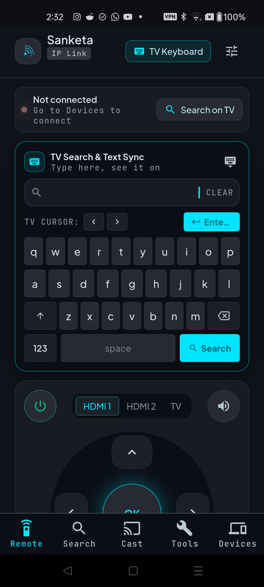
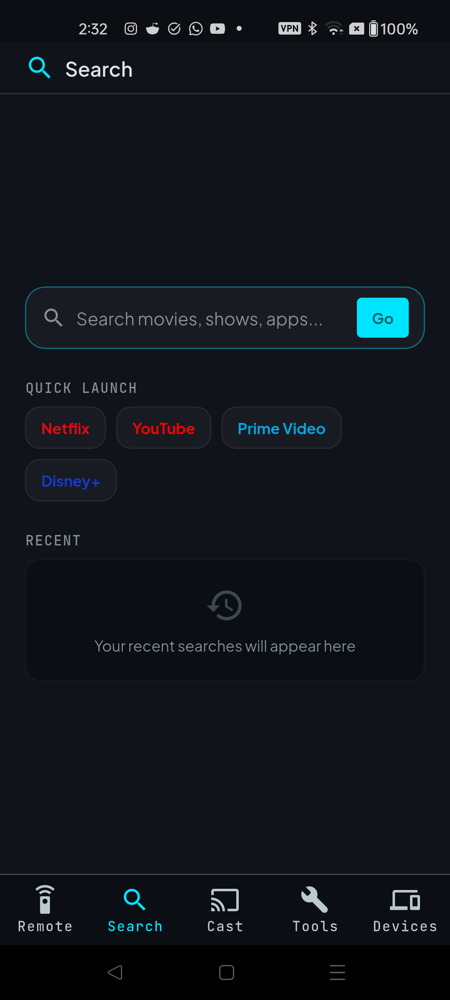
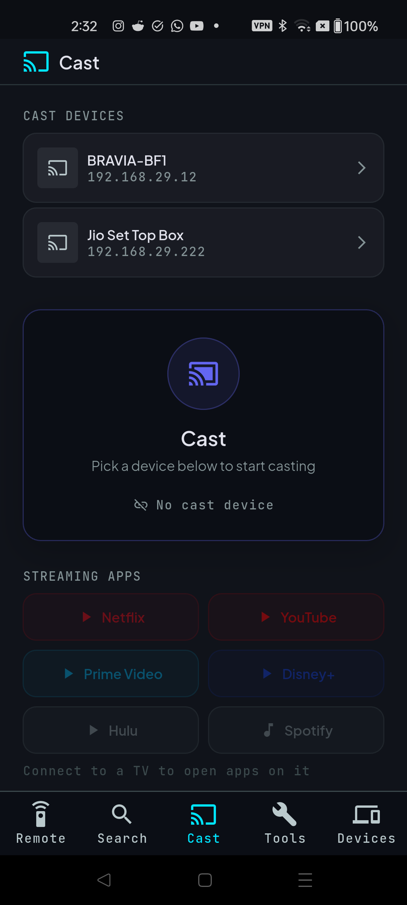
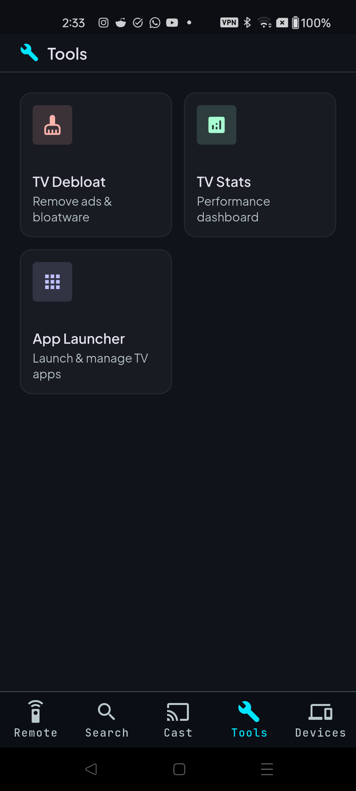
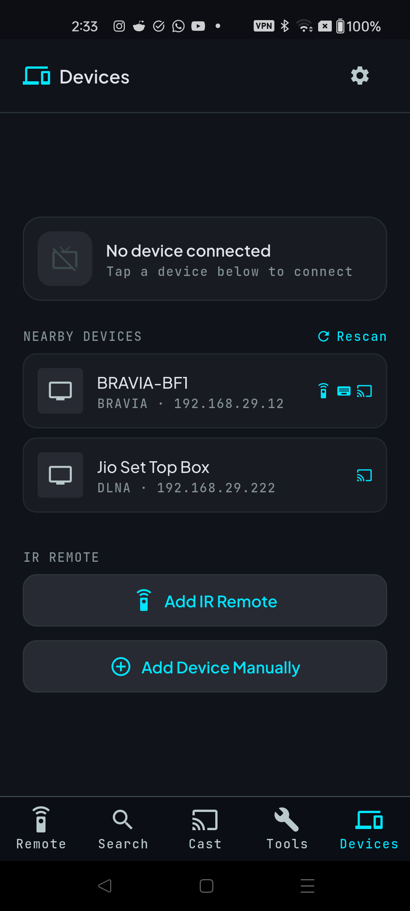

# SANKETA (संकेत)

Universal TV remote and casting platform for mobile. One app that controls **any**
TV — network protocols for smart platforms, infrared for everything else — replaces
arrow-key TV typing with the phone keyboard/voice (the hero feature), and casts local
media to the screen.

> **Start here:** [CONTEXT.md](CONTEXT.md) for current status and decisions, then the
> [PRD](SANKETA_PRD_v0.1.md) for requirements. Do not read the full PRD to answer a
> status question — that is what CONTEXT.md is for.

## Status

🟢 **Phase 0 hardware validation complete on 3 TVs (Haier, Samsung BU8000, Sony BRAVIA 2 II).**

- **411+ tests passing** across 7 packages, all analyzers clean
- **64 tool cards** in the Tools grid covering remote control, diagnostics, parental, accessibility, gaming, casting, and TV management
- **17 core screens**: Remote, Search, Cast, Tools, Devices, Settings + Debloat, IPTV, Performance, App Launcher, Macros, Touchpad, Connection Doctor, Custom Layouts, Search Shortcuts
- **47 beyond-roadmap feature screens** across 11 batches (see Tools section below)
- **14 platform adapters**: Android TV, Samsung Tizen, LG webOS, Roku, Sony BRAVIA, Fire TV, Vizio SmartCast, DLNA, Google Cast, DIAL, BroadLink bridge, SwitchBot bridge, Panasonic Viera, Philips JointSpace
- **10,550 IR codesets** across 2,907 brands (Flipper IRDB + Kookong decrypted database)
- **5 value-add features (F1–F5)** built, integrated, and UI-verified on device
- **ATVRS keyboard typing** (the hero feature) fully hardware-validated: type on phone → see it on TV → submit search

## Key features

| Feature | Description | Status |
|---|---|---|
| **Live TV Keyboard** | Type on phone, see it on TV in real time via ATVRS IME protocol | ✅ HW-validated |
| **Universal Remote** | D-pad, volume, channels, power, HDMI input switching, app launch | ✅ HW-validated |
| **Auto Discovery** | SSDP + mDNS + TCP probe finds every TV on the LAN | ✅ HW-validated |
| **One-time Pairing** | ATVRS protobuf TLS handshake, stored client cert | ✅ HW-validated |
| **F1 TV Debloat** | Disable bloatware/ads on Android TVs via ADB (69 entries, 7 brands) | ✅ Built |
| **F2 Free TV/IPTV** | Browse 10K+ free channels, watch in-app or cast to TV | ✅ Built |
| **F3 HLS Ad-Skip** | SCTE-35/CUE-OUT manifest rewriter + LAN proxy for ad-free streaming | ✅ Built |
| **F4 Performance Dashboard** | Live CPU, memory, storage, process stats from TV via ADB | ✅ Built |
| **F5 Smart App Launcher** | Browse, search, pin, and launch TV apps from phone | ✅ Built |
| **IR Remote** | NEC/Samsung/Sony SIRC/RC5/Coolix AC encoders, D-pad assist typer | ✅ Built |
| **Google Cast** | CastV2 TLS protocol on port 8009 | ✅ HW-validated |
| **DLNA Casting** | UPnP AVTransport/RenderingControl with human-readable errors | ✅ HW-validated |
| **Touchpad Mode** | Swipe→D-pad, tap→OK, double-tap→Back, long-press→Menu | ✅ Built |
| **Macro Automation** | Record, save, and replay TV command sequences | ✅ Built |
| **Sleep Timer** | Auto power-off with countdown, 6 presets (15m–2h) | ✅ Built |
| **Quick Actions** | Searchable command palette: power, mute, HDMI, app launch | ✅ Built |
| **Connection Doctor** | Guided troubleshooting: port scan, protocol probe | ✅ Built |
| **Custom Layouts** | Drag-and-drop remote button editor, saved as JSON profiles | ✅ Built |
| **Search Shortcuts** | Save and replay search queries across adapters | ✅ Built |
| **Panasonic Viera** | SOAP control on port 55000, PIN pairing | ✅ Built |
| **Philips JointSpace** | REST v6 control, Digest auth pairing | ✅ Built |

## Tools grid (64 features)

The Tools screen exposes a growing grid of TV companion utilities, all built with the OmniBeam design system and wired to `RemoteScope`:

| Batch | Features |
|---|---|
| Core | Debloat, TV Stats, App Launcher, Doctor, Macros, Touchpad, Shortcuts, Layouts, Screen Mirror, Rooms, Usage Analytics, Video Hand-off, Widgets, Wearable, Voice, Backup |
| 1 | Favourite Channels, Gesture Shortcuts, Scheduled Actions |
| 2 | Quick Text, HDMI Manager, Activity History, Remote Profiles |
| 3 | Night Mode, Button Mapper, CEC Devices, Universal Search |
| 5 | Remote Lock, Picture Settings, Sound Settings, Share Setup, Game Pad |
| 6 | Ambient Display, Subtitle Manager, Quick Dashboard, Motion Control, Channel Guide |
| 7 | Parental Timer, Accessibility, Remote Themes, Volume Limiter, Wake-on-LAN |
| 8 | Quick Dial Pad, Media Info, Screen Timeout, Energy Monitor, IR Learning |
| 9 | Sleep Sounds, Multi-TV Switcher, Input Rename, Diagnostic Log, Colour Test Patterns |
| 10 | Child Profile, Network Info, TV App Manager, Remote Clipboard, Whistle Finder |
| 11 | Firmware Info, Notification Manager, Speed Test, Power Schedule, Aspect Ratio |

All feature screens persist settings locally as JSON, never send data off-device, and pass analysis clean.

## Screenshots

<p align="center">
  
  
  
  
  
</p>

**Remote** - TV keyboard, D-pad, HDMI input switching, volume | **Search** - Quick launch streaming apps | **Cast** - Discovered devices, streaming app launchers | **Tools** - TV Debloat, TV Stats, App Launcher | **Devices** - Auto-discovered TVs with protocol icons, IR remote setup

## Hardware validation

| TV | Protocol | Tested |
|---|---|---|
| Sony BRAVIA 2 II | Simple IP (TCP 20060) + ATVRS (TLS 6466/6467) + Google Cast (8009) | ✅ |
| Haier TV | ATVRS keyboard typing + submit/search | ✅ |
| Samsung BU8000 65" | ATVRS keyboard typing + submit/search | ✅ |

## Repository layout

```
SANKETA/
├─ SANKETA_PRD_v0.1.md   Requirements (authoritative for what/why)
├─ CONTEXT.md            Status, decisions, build tracker (authoritative for where we are)
├─ BUG_FIX_PLAN.md       Bug audit: 19/24 bugs fixed across 5 tiers
├─ THIRD_PARTY_NOTICES.md License notices for bundled data
├─ sanketa_core/         Pure-Dart core (no Flutter, no deps)
│  └─ lib/src/
│     ├─ adapter/        ControlAdapter — the interface every brand implements
│     ├─ discovery/      Classifier + dedup registry + bounded scan engine
│     ├─ session/        Connection lifecycle, heartbeat, and reconnect manager
│     └─ model/          Key, TextOp, CapabilityMap, Device, Pairing, StateDelta
├─ sanketa_adapters/     Brand adapters + value-add services
│  └─ lib/src/
│     ├─ android_tv/     ATVRS protobuf/TLS (typing hero) + pairing
│     ├─ bravia/         Simple IP + ATVRS dual-channel
│     ├─ tizen/          Samsung WebSocket + token auth
│     ├─ webos/          LG SSAP + pointer + IME
│     ├─ roku/           ECP REST
│     ├─ fire_tv/        ADB-over-network
│     ├─ vizio/          SmartCast HTTPS
│     ├─ dlna/           UPnP AVTransport/RenderingControl
│     ├─ dial/           DIAL app launch
│     ├─ broadlink/      BroadLink RM WiFi-IR bridge (local UDP, AES-128-CBC)
│     ├─ cast/           Google CastV2 TLS
│     ├─ hls/            HLS ad-skip proxy (SCTE-35)
│     ├─ iptv/           M3U parser + iptv-org catalog
│     ├─ debloat/        Bloatware database + ADB disable
│     ├─ switchbot/      SwitchBot Hub WiFi-IR bridge (cloud API, opt-in)
│     ├─ panasonic/      Panasonic Viera SOAP (port 55000)
│     ├─ philips/        Philips JointSpace REST v6 (port 1925/1926)
│     └─ adb/            ADB command layer for tools features
├─ sanketa_discovery/    Real socket discovery backends
│  └─ lib/src/           ssdp_backend · mdns_backend · probe_backend · broadlink_backend
├─ sanketa_ir/           IR subsystem (any TV ever made, offline)
│  └─ lib/src/
│     ├─ ir_codec.dart   NEC/Samsung/SIRC/RC5/raw encoders
│     ├─ ac/             Coolix AC full-state encoder
│     ├─ assist/         D-pad shortest-path typing
│     └─ irdb/           10,550 codesets (Flipper + Kookong)
├─ sanketa_design/       OmniBeam design tokens (colours · type · spacing · elevation)
├─ sanketa_app/          Flutter app — 64 tool cards + 6 core tabs
│  └─ lib/
│     ├─ control/        RemoteController, MacroService, SleepTimerService, CustomLayoutService
│     ├─ screens/        Remote, Search, Cast, Tools (64 features), Devices, Settings
│     ├─ widgets/        TvKeyboardSheet, RemotePad, ConnectionBar, TouchpadSurface,
│     │                  QuickActionsSheet, SleepTimerSheet, SearchShortcutsWidget
│     ├─ theme/          OmniBeam dark theme
│     └─ native/         Platform channels (IR, ADB)
└─ design/               Stitch design source
```

## Running the app

```bash
cd sanketa_app && flutter run
```

Requires Flutter 3.47.2+ / Dart 3.12.2+. The app starts with device discovery,
routes controls through the selected network or IR adapter. On Android, discovery
uses the multicast lock and IR-capable phones use `ConsumerIrManager` through a
platform channel.

## Running tests

```bash
# All packages
for dir in sanketa_core sanketa_adapters sanketa_discovery sanketa_ir sanketa_design sanketa_app; do
  (cd $dir && dart pub get && dart test)
done
```

## The coverage ladder ("any brand, old and new")

Universal reach comes from a fallback ladder, not one protocol:

| Rung | Layer | Status |
|---|---|---|
| 5 | Native smart TV protocols (Android TV, Tizen, webOS, Roku, BRAVIA) | ✅ Built + HW-validated |
| 4 | Generic network (DLNA, DIAL, Google Cast) | ✅ Built + HW-validated |
| 3 | Phone IR blaster (NEC/Samsung/SIRC/RC5/AC, 10,550 codesets) | ✅ Built |
| 2 | WiFi→IR bridge (BroadLink, SwitchBot) | ✅ Built |
| 1 | Manual learning (point and capture via bridge) | ✅ Built |

A device is served by the highest rung it reaches. IR is the backstop that reaches
everything with an IR receiver.

## Architecture in one paragraph

A Flutter UI shell sits over a platform-agnostic core. Every controllable target —
Android TV, Tizen, webOS, Roku, BRAVIA, an IR blaster, a BroadLink bridge — implements
the **one** `ControlAdapter` interface. Nothing above that interface knows brands exist;
**capability flags, never brand names, drive the UI.** Adding a brand touches zero core
code (NFR-14). That contract is the moat.

## Design red lines (see CONTEXT.md §9)

- Typed text is never logged, analysed, or sent anywhere except the target TV.
- Zero third-party ads, ever. No account required except optional encrypted sync.
- The control plane makes zero calls to SANKETA servers. IR works fully offline.
- No DRM circumvention. No private APIs. No raw error codes in user-facing copy.
- Pairing secrets in hardware-backed stores. Media server LAN-bound, tokened, ephemeral.

## Recent changes (Nov 2026)

- **64 tool cards** across 11 beyond-roadmap feature batches in the Tools grid
- **411 tests passing** (core 80, adapters 228, design 12, IR 72, app 19)
- **15 keyboard languages** including Hindi, Arabic (RTL), Korean, Japanese, Thai
- **Native Android platform features**: permissions, share intent, AppWidget, TOFU cert store
- **ADB reconnect storm fix**: socket cleanup, auth timeout, connect guard
- **ATVRS keyboard submit fix** — IME commit wire-type corrected, HW-validated on 3 TVs
- **19/24 bugs fixed** across keyboard, connection, UI, discovery, and cast tiers
- **F1–F5 value-add features** built end-to-end with security review
- **Google Cast validated** on Sony BRAVIA (CastV2 TLS, port 8009)
- **Production socket layer** wired for all 7 control adapters

## License

Proprietary. All rights reserved.
